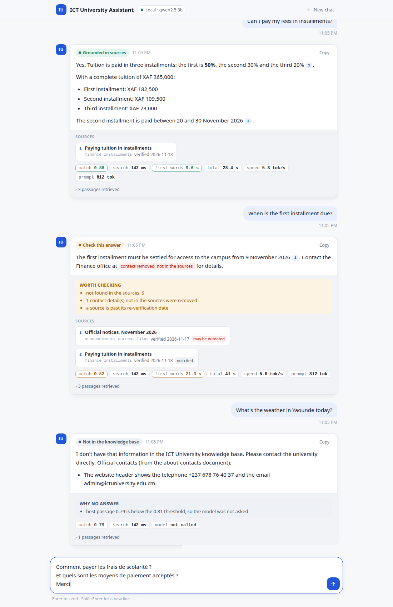
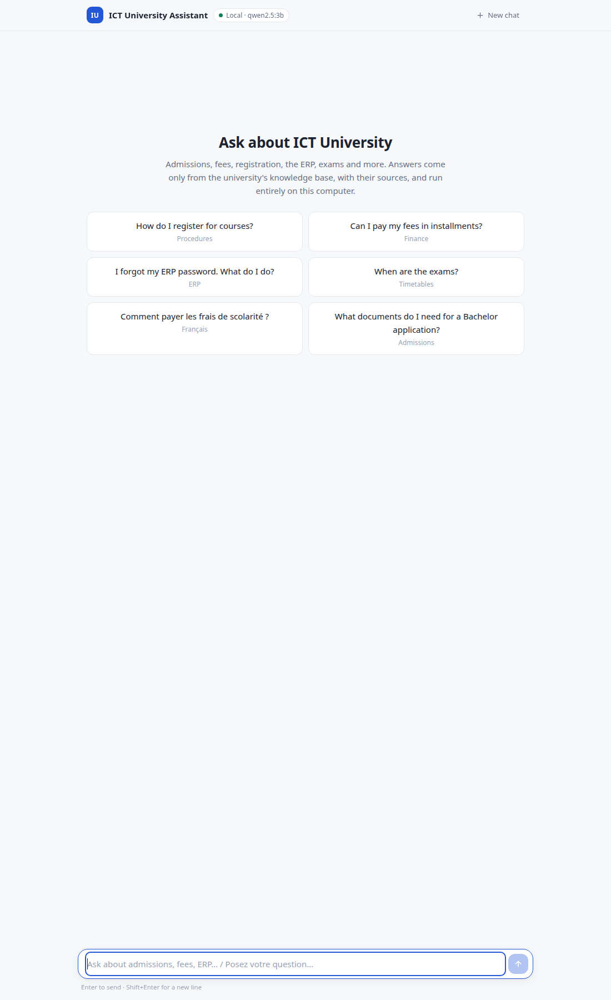
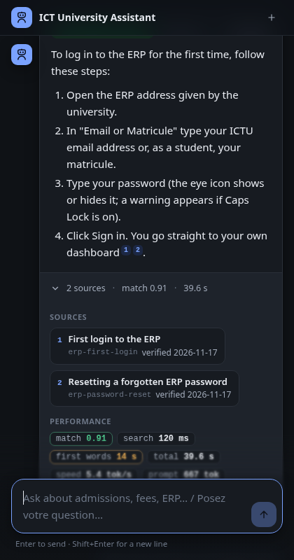
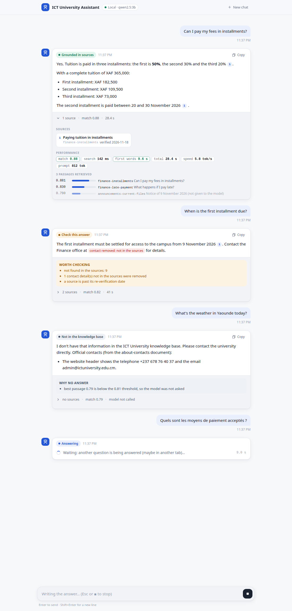
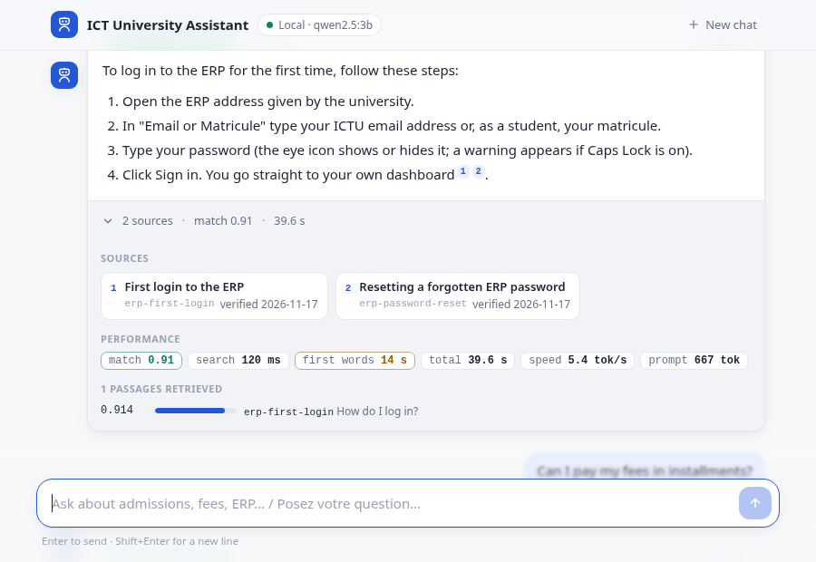

# 05. Packaging and a web page (Phase 5)

**Purpose:** make the assistant easy to set up again (for a demo, a fresh machine, or the course report) and easy to
use for someone who doesn't want a terminal. The chatbot stays ours: it lives in `chatbot/` on our fork's
`local-chatbot` branch and is not contributed to the shared knowledge base. (The fork is public, so it can be read,
but it never goes upstream.)

## Two commands

```bash
./chatbot/setup.sh      # one time
./chatbot/run.sh        # terminal chat;  ./chatbot/run.sh --web  for the browser page
```

### What `setup.sh` does, and why each step is there

| Step | What | Why it's scripted this way |
|---|---|---|
| 1 | Checks Python 3.11+, Docker usable without sudo, Ollama installed and running | These were our Phase 0-1 obstacles (Docker Desktop context, docker group). The script prints the exact fix instead of failing later with a cryptic error |
| 2 | `.venv` + `pip install -e ".[dev,local-embeddings]"` | The repo's own extras only; pip's noisy output goes to `.venv/setup-pip.log` and is shown only on failure |
| 3 | Copies `chatbot/env.template` to `.env` **only if `.env` doesn't exist**; otherwise checks it uses `fastembed` | Never overwrite a user's settings; refuse to continue with a cloud provider |
| 4 | Starts only the `db` container, waits until it accepts connections, runs `ictkb migrate` | A fixed `sleep` would be flaky; `pg_isready` is exact |
| 5 | `ictkb validate`, `ictkb index` (and `ictkb crawl` with `--crawl`) | Indexing is incremental (content hashes), so a re-run is quick |
| 6 | `ollama pull qwen2.5:3b` if missing | |
| 7 | Unit tests + one search | Proves the installation works before you rely on it |

`FASTEMBED_CACHE_PATH` is exported by both scripts, so the 2.2 GB model can never land in `/tmp` again (failure
log #2 and #3). The scripts never call `sudo`: system installs stay the user's decision.

**Tested:** a full re-run on the development laptop finished in 15 s with nothing re-indexed (77 unchanged), the
existing `.env` kept byte for byte, 22 tests passing and the registration search correct. The failure path was
tested in a shell without Docker access: it stops at step 1 with "Run: sudo usermod -aG docker ...". Not tested:
a first run on a fresh machine (the download steps were each exercised in Phase 1, but not through the script).

### `run.sh`

Starts the database if it isn't up, checks Ollama, then runs the terminal chat, or the web page with `--web`.

## The web page

`./chatbot/run.sh --web`, then open http://127.0.0.1:8765.

- **Same pipeline** as the terminal (`chat.Assistant`), so every safeguard applies: the similarity threshold, the
  redaction of invented contacts, the number/date check, draft and stale notes.
- **Streams** the answer as it's written: the server sends newline-delimited JSON events (`text` pieces, then a
  `done` event with confidence, cited sources, passages and timings). The page shows the text line by line, styles
  sources, notes and warnings, and offers "details" (which passages were retrieved and which were given to the model).
- **No new dependency, works offline:** Python's `http.server`; one HTML file with inline CSS and JavaScript; no CDN,
  no fonts from the internet. Light and dark themes follow the system.
- **Local and safe by design:**
  - listens on 127.0.0.1 only;
  - accepts only `application/json` requests (a form on another website can't send that without a browser
    preflight check, which the server never approves);
  - refuses any `Host` other than `127.0.0.1`/`localhost` (blocks "DNS rebinding", where a website points its own
    name at your machine);
  - inserts everything as text, never as HTML, and only makes `http(s)` links clickable;
  - answers one question at a time (the embedding model, the database connection and Ollama are shared).
- **Tested:** 7 unit tests with a fake assistant (streaming, bad input, wrong content type, foreign host name), and a
  live request through `run.sh --web`: correct, cited installment answer, first words after 26 s, done in 44 s.

## Redesign after the first review

The first version of the page worked but was rejected in review: "lazy and boring", odd interactions, a scrollbar in
the text field. What was wrong, and what changed:

| Problem | Cause | Now |
|---|---|---|
| Scrollbar in a one-line text field | Fixed 48 px height with 12 px padding and a ~25 px line: one line needed ~49 px | The field starts at one line, grows with the text up to ~8 lines (200 px), and only then scrolls; recomputed on resize |
| Example questions sent immediately | Chips called "send" directly | Suggestion cards fill the composer; you edit or press Enter |
| Page jumped to the bottom on every streamed word | Unconditional scrolling | Follows the answer only if you are already at the bottom; otherwise a "↓ Latest" button appears |
| No way to stop an answer | - | The send button becomes Stop while an answer is written (closing the request also stops Ollama) |
| Sources, notes and metrics mixed into the answer text | The server streamed the terminal's output, footer included | The server streams **only the answer text**; sources, notes, contacts and metrics arrive as structured data and get their own panel |
| A blank 20-40 s wait | No progress information | Live progress: "Searching…", then "Found 4 passages (best match 0.88) · writing…", with a running timer |
| No sense of how the model behaved | - | A colour-coded status on every answer (below) |

**Behaviour status** (computed on the server from the same checks the terminal uses):

| Badge | Meaning |
|---|---|
| green *Grounded in sources* | the model answered and cited sources; no check flagged anything |
| amber *Check this answer* | something deserves a look, listed under "Worth checking": no citation, a number or date not found in the sources, a removed contact, a draft or outdated source, an answer stopped early |
| slate *Not in the knowledge base* | below the similarity threshold (model not called), only unfilled drafts, or the model found no answer; the reason is shown |

Each answer card also has: citation chips that jump to their source card; source cards with title, document id,
verification date and *draft* / *may be outdated* / *not cited* tags; a metrics strip (match score coloured by its
margin over the threshold, search time, time to first words coloured by speed, total time, tokens/s, prompt size);
a collapsible list of all retrieved passages with similarity bars and which ones the model saw; a Copy button;
a timestamp. User messages are right-aligned bubbles with timestamps. Light and dark themes, phone layout.

To support this, `Assistant.answer()` gained two optional parameters (`footer`, `on_retrieval`); the terminal output
is unchanged (checked by running the terminal on a fallback and a cited question after the change).



*Rendered in headless Chrome with sample answers (a mocked server), to check the layout without the models.*

| Start screen | Phone, dark theme |
|---|---|
|  |  |

**Checked visually before showing it**: the first render exposed three bugs that the unit tests couldn't see (the
progress row stayed visible because `display: flex` overrode the `hidden` attribute; lists after an intro line
weren't recognised; a double focus outline), and the phone view showed a wrapping top bar and a clipped composer. All
fixed and re-rendered. Live check against the real models: the new events work, and the "not found" status reported
a refusal in which the redactor had removed an invented address. That case led to one more fix: a refusal now also
lists the removed contact among its reasons.

### Second review

| Feedback | Change |
|---|---|
| Sending while an answer is written interrupts it | Enter submitted the form, and while busy "submit" meant Stop. The text field is now **locked while an answer is written**; only the Stop button or **Esc** stops |
| Two tabs: the second waits for the first | Kept on purpose (one shared CPU, model and database connection; answering both at once would make each about twice as slow on this laptop), but now **visible**: the server sends a `queued` event and the second tab shows "Waiting: another question is being answered (maybe in another tab)…" |
| Sources and details should collapse | Sources, performance and passages sit in one **accordion** with a one-line summary ("2 sources · match 0.82 · 41 s"), closed by default. *Worth checking* and contacts stay visible: they're safety information |
| Smooth open/close | The native `<details>` can't animate its height in most browsers, so the accordion is a button plus a CSS grid row animating from `0fr` to `1fr` (and opacity); closed content is `inert` (skipped by Tab and screen readers); reduced-motion users get no animation |
| No scrollbar in the text field | Hidden scrollbar; the field still scrolls with the wheel and keys past ~8 lines |
| Icon and copy button | Remix Icon `robot-3-line` (top bar, answers, browser tab) and `file-copy-line` + "Copy" (Apache 2.0, credited in the file) |
| Citations as superscripts | Citations are footnote numbers in their small pill containers, raised with `<sup>`, numbered by first appearance **while streaming**, the same order as the final source list, so numbers don't change when the answer completes; repeated citations collapse into one; clicking a number opens the sources and highlights the card |



### Third review

| Feedback | Change |
|---|---|
| Blur behind the top bar | The blur was already there but invisible: the page was a column (bar, messages, composer), so nothing ever scrolled *under* the bar. The conversation now fills the window and the bar and composer float over it; their real heights are kept in CSS variables by a `ResizeObserver` (the composer grows with the text), and the conversation is padded to stay clear of both. The bar is frosted (blur + saturation over a semi-transparent background) |
| Sticky avatar | The answer's avatar is `position: sticky` inside its own grid row: it stays just under the top bar while its answer is on screen and leaves with it |
| Progressive blur behind the composer | Five stacked layers: four `backdrop-filter` blurs (1, 2, 4, 8 px), each masked to a lower band, plus a fade into the background colour, so messages dissolve gradually instead of being cut off |
| Citations not lined up with what they cite | Two causes. (1) The pills were inline-*block*: browsers may break a line before such a box, leaving a number alone at the start of the next line; they are now inline (with `box-decoration-break: clone`), glued to the cited word. (2) The model often writes citations on a line of their own under a list ("[erp-first-login] [erp-first-login]"); that line became its own paragraph. Such lines are now attached to the previous sentence or list item, before its final punctuation, and footnotes already there aren't repeated: "dashboard¹ ²." |



## Trade-offs

| Choice | Gained | Gave up |
|---|---|---|
| Shell scripts, not a Python installer or Makefile | Readable, no extra tool, matches how we set it up by hand | Linux/macOS only (Windows would need WSL) |
| Scripts don't install Docker or Ollama | No `sudo` in our scripts; the user stays in control | Two manual installs on a fresh machine |
| Standard-library web server | No dependency, nothing to keep updated | No multi-user features; one question at a time |
| Stream raw text + a summary event | Same output as the terminal, little code | The page parses lines to style them; a format change in the terminal output changes the page |
